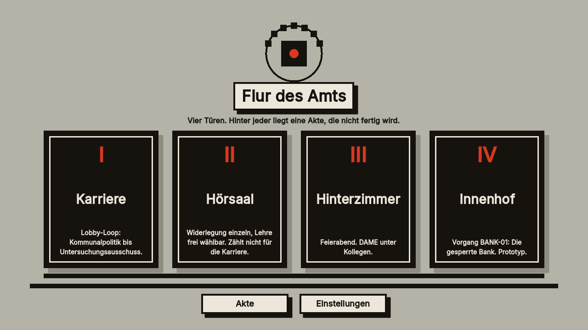
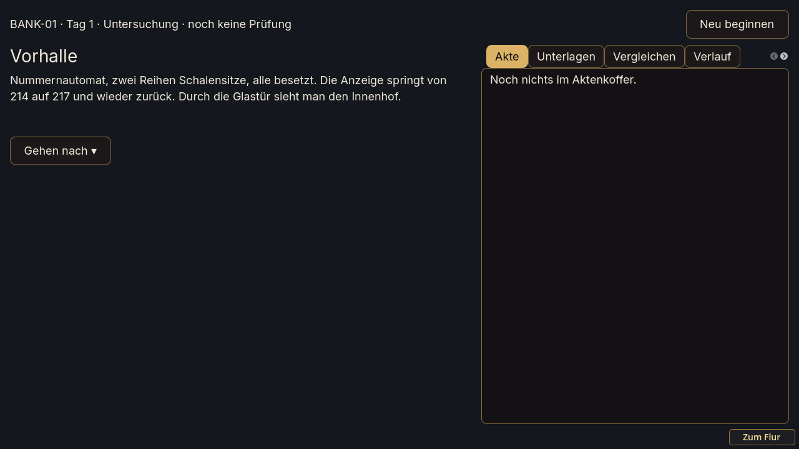
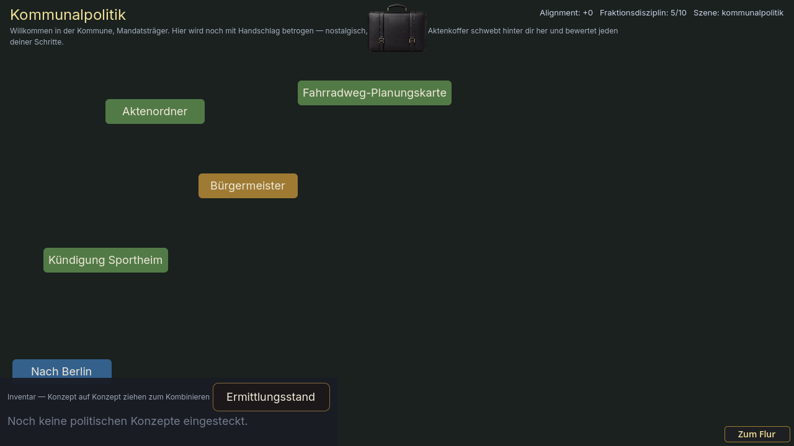
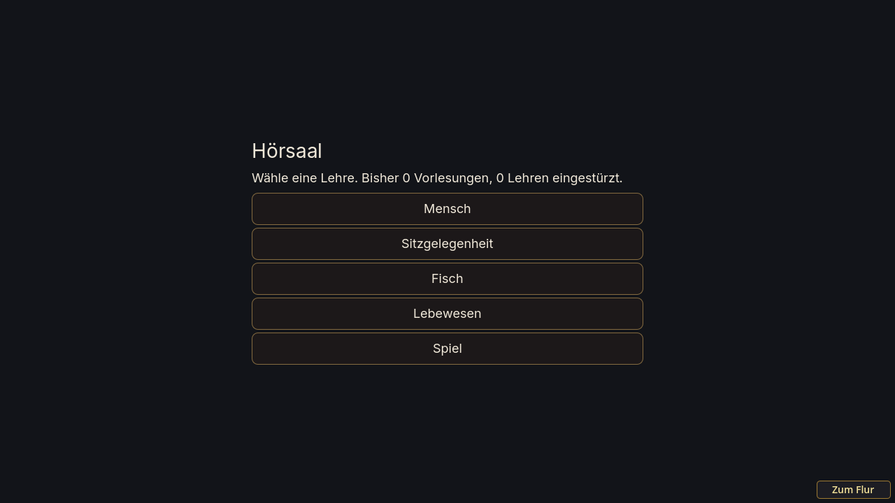
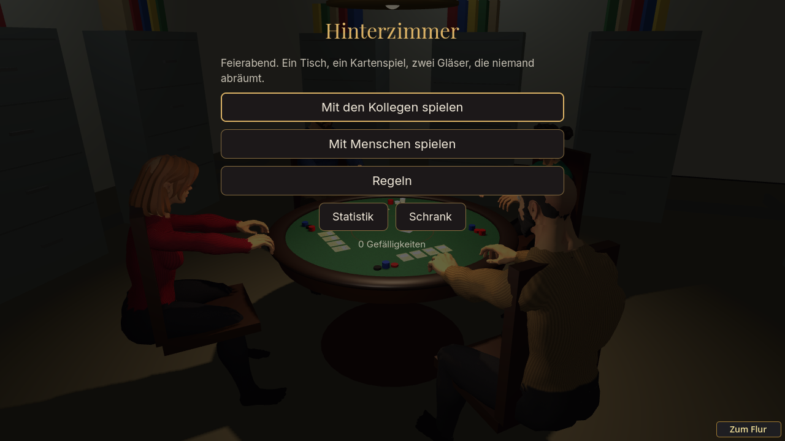
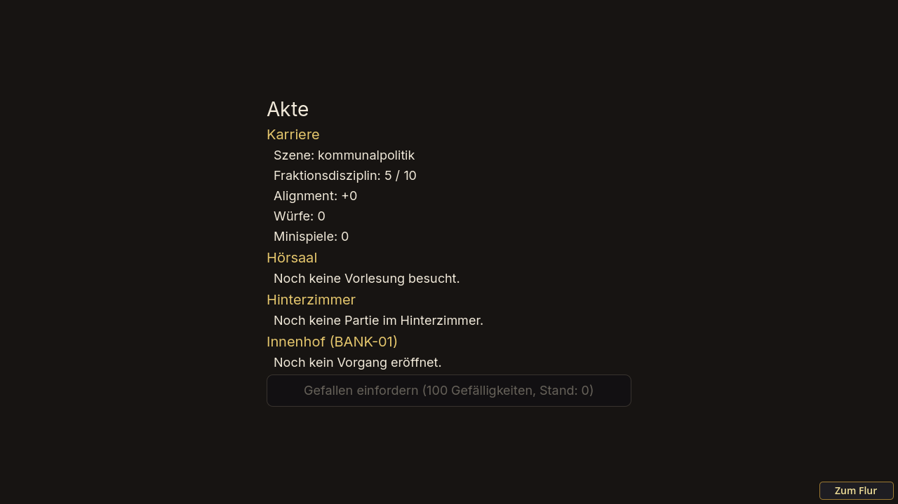

# Latte

**Die Latte liegt am Boden.** Eine Spielwelt über ein Amt, das so tut, als sei alles in Ordnung.

Du betrittst den Flur. Vier Türen, hinter jeder liegt eine Akte, die nicht fertig wird. Du wirst vieles verlieren. Die Frage ist, was du mitnimmst.

Latte ist ein Herzensprojekt, kein Produkt: Es soll Spaß machen und etwas zeigen, nämlich den Unterschied zwischen Kulisse und Fundament. Es gibt keinen Shop, keine Werbung und kein Konto.

## Ausprobieren

**Im Browser, ohne Installation:** <https://deusexlumen.github.io/latte-app/>
Am Rechner mit Maus und Tastatur (mindestens 1280 × 720, Ton an). Das erste Laden dauert einen Moment (rund 50 MB).

**Auf Windows:** unter [Releases](../../releases) die Datei `Latte.exe` laden und doppelklicken. Sie ist nicht signiert, Windows zeigt deshalb vielleicht eine Warnung: „Weitere Informationen“, dann „Trotzdem ausführen“. Installieren muss man nichts.

## Die vier Türen

### I. Innenhof: der Vorgang „Die gesperrte Bank“

Frau Kern wartet und möchte sich hinsetzen. Hier fängt man an: etwa 45 Minuten, am besten ohne Vorwissen. Du sammelst Belege, sprichst mit den Leuten im Amt und siehst, wie aus dem, was passiert ist, eine amtliche Fassung wird.

### II. Karriere

Lobby-Loop, ein Point-and-Click-Rollenspiel von der Kommunalpolitik bis zum Untersuchungsausschuss. Im Browser ohne KI-Spielleiter, dann spielen die vorgeschriebenen Szenen.

### III. Hörsaal

Widerlegung: Eine Lehre soll tragen, du suchst die Stelle, an der sie einstürzt. Frei wählbar, zählt nicht für die Karriere.

### IV. Hinterzimmer

Feierabend. DAME, ein Kartenspiel aus Gedächtnis und Bluff, gegen Kollegen oder online mit Menschen (Raumcode).

Dazu die **Akte**, in der jedes Spiel einen Abschnitt hat (unten ein Blick hinein), und die **Einstellungen** (Sprache, Ton, Vollbild). Der Knopf „Zum Flur“ unten rechts, oder die Taste Esc, bringt dich jederzeit zurück.

## Gut zu wissen

- **Es gibt kein Richtig oder Falsch.** Probier aus, hör auf, wenn du magst.
- **Spielstand:** liegt im Browser (oder auf deinem Rechner bei der Windows-Version) und gehört dir. Wer im Browser die Websitedaten löscht, löscht auch den Spielstand.
- **Sprache:** Das Amt spricht Deutsch. Auf Englisch umschaltbar (Einstellungen) sind bisher der Flur, der Hörsaal, das Hinterzimmer samt Kartenspiel DAME und der Rahmen der Akte; die Geschichten (Innenhof, Karriere) folgen. / The Office speaks German. You can switch to English in Settings: the corridor, lecture hall, back room with the card game DAME and the file frame are translated so far; the stories (courtyard, career) will follow.
- **Es ist ein Prototyp.** Vieles ist unfertig, manches ist Absicht. Genau dazu brauche ich dich.

## Rückmeldung

Beschreib kurz, was passiert ist und wo du hängengeblieben bist oder gelacht hast: [Rückmeldung geben](../../issues/new?template=rueckmeldung.yml). Ein Konto bei GitHub ist dafür nötig. Wer keins hat, sagt es dem Menschen, der ihm den Link geschickt hat.

Besonders hilfreich: **Wo wusstest du nicht weiter? Woran erinnerst du dich später noch?**

## Für Entwickler

Aufbau, Befehle, Tests, Sync der Spiele: [`docs/entwicklung.md`](docs/entwicklung.md). Stand und Entscheidungen: [`SESSION_NOTES.md`](SESSION_NOTES.md). Was als Nächstes kommt: [`docs/fahrplan-2026-10.md`](docs/fahrplan-2026-10.md).

Die verwendeten Schriften, Töne und Figuren stehen mit ihren Lizenzen unter `addons/dame/assets/`. Die Bilder oben entstehen aus einem echten Lauf: `tools/screenshots.gd`.
