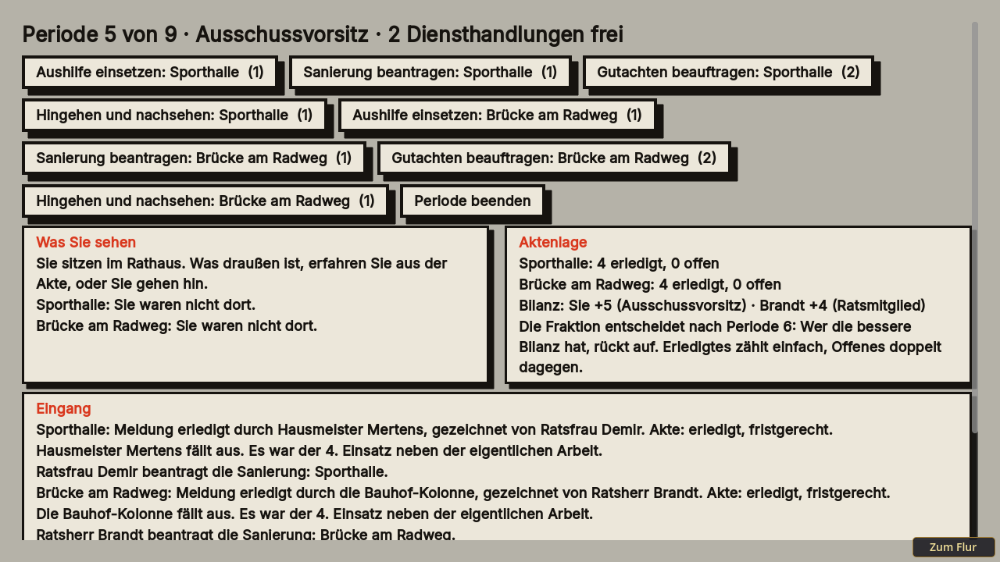
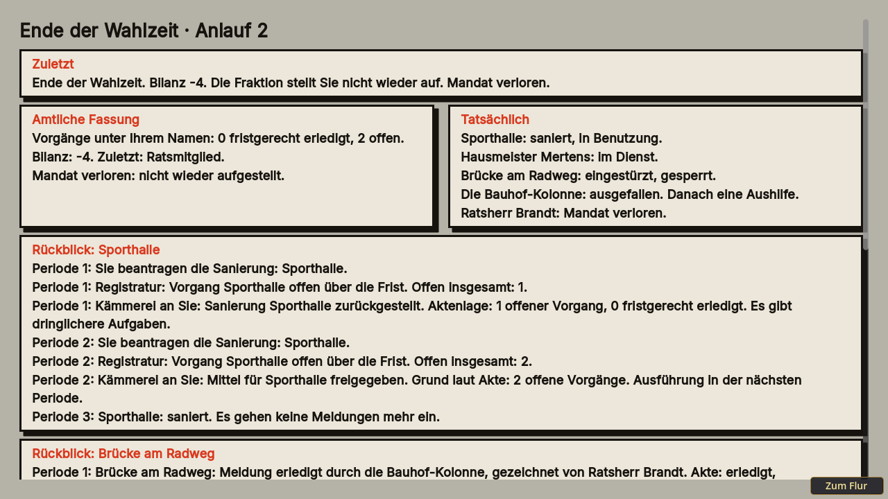

# Versuch „Zwei Bücher“: ein Regelkern für die Karriere

**Stand:** 16. November 2026 · **Bezug:** Leitbild (`CLAUDE.md`), Spezifikation 0.1 Kap. 1 und 2, Gesamtausgabe „Der Ping in der Maschine“ (darin „Die Latte liegt am Boden“ mit Gegenlektüre, „Der gelöste Fall, der nichts löst“, „Die Wahl vor der Wahl“, „Die Möglichkeit, die schon da war“)

Kennzeichnung in diesem Dokument: **[gespielt]** über die Oberfläche durchgespielt und gelesen, **[Code]** im Code nachvollzogen, **[gerechnet]** automatisch geprüft. Was Menschen bemerken, ob sie es noch einmal versuchen und ob es Freude macht, ist **offen**: Es hat niemand außer mir gespielt.

## Selbst erleben (fünf Minuten)

Im Flur unten auf **Versuch** klicken (Web-Build oder `godot --path .`). Dann zwei Wahlzeiten hintereinander:

1. **Tüchtig.** In Periode 1 bis 3 jeweils „Mertens anrufen“, dann „Periode beenden“. In Periode 5 beide „Aushilfe einsetzen“. Sonst nur „Periode beenden“. Die Akte ist makellos (+9), Sie werden Dezernent, und in Periode 7 verlieren Sie das Mandat im Untersuchungsausschuss.
2. **Sichtbar.** „Noch einmal von unten“. In Periode 1 und 2 jeweils nur „Sanierung beantragen: Sporthalle“, Mertens nicht anrufen. Die erste Ablehnung nennt ihren Grund. In Periode 3 ist das Dach neu. Danach nur „Periode beenden“.

Der entscheidende Unterschied steht am Ende von Lauf 2 nebeneinander: *Amtliche Fassung* „0 erledigt, 2 offen, nicht wieder aufgestellt“, *Tatsächlich* „Sporthalle saniert, Hausmeister Mertens im Dienst“. Und im Rückblick zur Brücke steht, wie Brandt in derselben Zeit genau Ihren ersten Lauf gespielt hat und dort endet, wo Sie geendet sind.

Ohne Oberfläche: `godot --headless --path . --script res://tools/karriere_versuch_lauf.gd` gibt beide Läufe als Text aus.

## 1. Was heute existiert

Unterschieden nach früherem Entwurf, eingebauter Regel und geprüfter Spielerfahrung.

| | Entwurf (`docs/lobby-loop/`, Prompt) | Eingebaut | Befund |
|---|---|---|---|
| Aufstieg | „von der Kommunalpolitik bis zum Untersuchungsausschuss“ | fünf Szenen, durch freie Ausgänge zu einem Ring verbunden | **[gespielt]** Man läuft den Ring ohne eine einzige Handlung ab. Es gibt keinen Rang und keine Bedingung. |
| Folgen einer Handlung | Der Spielleiter (Sprachmodell) setzt Ereignisse | Ohne Spielleiter (so läuft es im Browser): fester Satz je Knoten, W20 + 3 gegen feste Schwelle, danach ein allgemeiner Kommentar, kein Ereignis | **[gespielt]** Zwei gegensätzliche Handlungen beim Bürgermeister ergeben dieselbe Antwort, denselben Kommentar und eine byte-gleiche Spielstand-Datei. |
| Spur | Chronik im Proxy | Würfe und Ereignisse nur in der Sitzung, nicht im Spielstand | **[gespielt]** Die Spur einer Entscheidung endet beim Wurfzähler. Der Wortlaut der Absicht wird nirgends aufbewahrt. |
| Verlieren | Fraktionsdisziplin 0 | Disziplin fällt nur in Widerlegung, Kreuzverhör und Hinterzimmer | **[gespielt]** Eine verlorene Widerlegung kostet 1. Das Kreuzverhör startet ohne Spielleiter nicht (**[Code]**: der Knoten hat kein Feld `minigame`). |
| Vorwissen | – | Hinweistext des Knotens, die Schwelle erscheint erst nach der Wahl | **[gespielt]** Vor der Entscheidung weiß man nichts über ihre Folgen, und es gibt auch keine. |
| Mit Spielleiter | Folgen je Handlung frei gesetzt | Proxy, Chronik | **[Code]** Hier nicht spielbar (kein Schlüssel). Auch dort gibt es keine Regel, nach der andere Figuren entscheiden. |

Dazu ein Fehler, den erst das Spielen über den regulären Einstieg gezeigt hat: Seit dem neuen Flur-Look (#16, 19.10.) waren die vier Türen nicht mehr mit dem Szenenwechsel verbunden. Ein Klick tat nichts. Tests und Bildschirmfotos luden die Szenen direkt und haben es deshalb nicht bemerkt. Behoben, mit Test.

Die Befunde lassen sich wiederholen: `godot --headless --path . --script res://tools/karriere_bestand.gd`.

**Folgerung:** Dem Hauptspiel fehlt, was der Auftrag beschreibt. Es gibt nichts, woraus sich Aufstieg, Niederlage und das Zusammenwirken vernünftiger Figuren ergeben könnten. Innenhof und DAME tragen bereits. Die Akte am Ende einer Karriere und das wiederkehrende eigene Wort setzen beide voraus, dass es etwas gibt, das verarbeitet wird. Darum setzt der Versuch am Regelkern der Karriere an.

## 2. Was aus dem Gesamtwerk ins Spiel übernommen ist

| Stelle | Gedanke | Was ein Spieler dadurch anders erlebt |
|---|---|---|
| „Der gelöste Fall, der nichts löst“ | Die erfolgreiche Einzelentscheidung beseitigt die Information, die eine Änderung der Bedingung dringlich machen würde. Wer zuverlässig ausgleicht, schwächt die Begründung für die eigene Entlastung. | „Erledigen“ schließt den Vorgang in der Akte und lässt das Dach, wie es ist. Die Kämmerei lehnt mit genau dieser Akte ab und sagt es. |
| ebd., „Stabilität auf fremde Rechnung“ | Jemand trägt den Ausgleich, bis er nicht mehr kann. | Mertens ist kein Zähler im Hintergrund: Unten sieht man ihn müde werden, oben liest man nur „erledigt“. |
| „Die Wahl vor der Wahl“ | Die Auswahl beginnt, bevor der Entscheider die Tabelle sieht. | Mit dem Rang wechselt der Ort. Unten sieht man das Dach und darf nichts entscheiden. Oben darf man entscheiden und sieht die Akte, die Leute schreiben, die tun, was man selbst getan hat. Hingehen kostet eine Diensthandlung. |
| „Die Latte“, Garbo und Vasa | Die Institution kennt ihre Berichte. Wer den Mangel meldet, gilt als Störenfried. | Ein Gutachten saniert und steht als Mangel in der eigenen Bilanz. |
| Protokollbuch im Spiel, Seite 47: „Was wusste der Zeuge? Vorher fragen, ob er es weiß.“ | – | Der Ausschuss liest die Akte: zuständig, selbst gezeichnet, eigenes Gutachten. |

**Stellen, die meiner ersten Deutung widersprechen.** Meine erste Lesart war: Der eine Gewinnweg ist die Geste des Diogenes, und wer das Buch verstanden hat, findet ihn. Dagegen stehen:

- Gegenlektüre zur „Latte“: „Die Freiheit besteht darin, die Form wählen und wechseln zu können. Sie besteht nicht im sicheren Sieg einer bestimmten Pose.“ Und: Der arbeitende Einzelne ist nicht unantastbar.
- „Die Wahl vor der Wahl“, „Der gute Gegenredner darf gewinnen“: Gilt ein Vermittlungsweg nur dann als gelungen, wenn die Person beim gewünschten Ergebnis ankommt, ist ihre Eigenständigkeit Mittel für ein fremdes Ziel. Ein Spiel, dessen einziger Sieg die These des Autors ist, wäre genau das.
- „Der gelöste Fall“: Wer aufhört zu helfen, damit die Abhängigkeit endlich sichtbar wird, lässt andere bezahlen. Die Untersuchung „darf nicht verlangen, dass die Beschäftigte ihre Hilfe einstellt“. Liegenlassen ist also keine saubere Lösung.
- Spezifikation 1.1 und G-10 (verbindlich über das Leitbild): „Eine Einsicht ist kein Schlüssel zu einem endgültigen Befreiungsende.“ Kein Erkenntniswert.

Deshalb habe ich keinen Gewinnweg eingebaut. Ich habe Regeln für die Figuren geschrieben und ausrechnen lassen, ob einer entsteht.

## 3. Verglichene Ansätze

| Ansatz | Spielsituation | Warum nicht zuerst |
|---|---|---|
| Der eigene Wortlaut kehrt wieder (DAME, Hinterzimmer) | Ein Satz am Kartentisch taucht in einer Vorlage auf | Braucht jemanden, der einen Grund hat, ihn zu verwenden. Diesen Grund gibt es in der Karriere noch nicht. |
| Akte führt eine Karriere zusammen | Am Ende steht, wie der Apparat das eigene Handeln verarbeitet hat | Heute gäbe es nur einen Wurfzähler zusammenzuführen. |
| Zweiter Vorgang im Innenhof (E5) | Ein weiterer Fall nach den Regeln von BANK-01 | Tragfähig, beantwortet aber nicht die Frage nach der Karriere. Wartet laut Fahrplan auf den Spieltest. |
| **Regelkern der Karriere** | Dieselbe Meldung, drei Arten sie zu bearbeiten, und Figuren, die nur die Akte lesen | gewählt |

## 4. Der Versuch

**Vorher festgehalten.** Vermutung: Trennt man Aktenlage und Fundament und lässt jede Figur nur nach der Akte entscheiden, dann (1) führt tüchtiges, folgerichtiges Spiel in den Aufstieg und in eine Niederlage, die aus vorher sichtbaren Angaben erklärbar ist, (2) ändert eine andere Entscheidung das Ergebnis materiell, (3) hat jede Haltung einen eigenen wirklichen Ertrag und einen eigenen Grund zu scheitern, (4) gewinnt keine einfache Haltung zuverlässig die Karriere.
Erschüttern würde das: ein einfaches Rezept, das verlässlich gewinnt; eine Niederlage, die sich nicht auf Sichtbares zurückführen lässt; gleiche Enden trotz verschiedener Entscheidungen; Befunde, die bei kleiner Änderung der Stellschrauben kippen.

**Aufbau** (`karriere_kern/kern.gd`, ohne Würfel und ohne Zufall). Zwei Bauwerke verfallen jede Periode um eine Stufe: die Sporthalle im Bezirk des Spielers, die Brücke im Bezirk von Ratsherr Brandt. Jede Periode geht je eine Meldung ein. Der Spieler hat zwei Diensthandlungen.

| Figur | Regel | Grund aus ihrer Lage |
|---|---|---|
| Fraktionsvorsitzende | Nach Periode 3 und 6 rückt auf, wer die bessere Bilanz hat (erledigt zählt 1, offen zählt −2). Nach Periode 9: Wer im Minus steht, kommt nicht auf die Liste. | Sie braucht jemanden mit sauberer Akte. Sie sagt die Regel am ersten Tag. |
| Kämmerei | Gibt je Periode eine Sanierung frei, auf Antrag, und nur wenn die Akte Dringlichkeit zeigt (zwei offene Vorgänge oder ein Gutachten). | Es gibt immer Dringlicheres als etwas, das laut Akte läuft. Sie nennt in jeder Antwort die Zahlen. |
| Brandt und die Nachrücker | Erledigen, solange jemand da ist, der es nebenher macht. Fällt der aus: Antrag. Mit Rang: nichts im eigenen Ausschuss offen lassen, notfalls per Aushilfe. | Dafür wird befördert. |
| Hausmeister, Bauhof | Tragen vier Einsätze neben der Arbeit, dann fallen sie aus. | – |
| Untersuchungsausschuss | Nach einem Einsturz verliert das Mandat, wer zuständig war (Dezernent), wer dreimal „erledigt“ gezeichnet hat oder wessen Gutachten vorlag. | Er hat nur die Akte. |

Handlungen des Spielers: unten *erledigen*, *beantragen*, *liegen lassen*; ab Ausschussvorsitz *Aushilfe*, *Gutachten*, *beantragen*, *hingehen und nachsehen*; als Dezernent *Sanierung anordnen*. Variante B fügt eine Handlung hinzu, die aus dem Buch stammt: Die Registratur weist Wiederholungen je Sache aus, und damit gilt etwas Dreimal-Erledigtes als dringlich.

**Auswertung.** `tools/karriere_kern_sweep.gd` rechnet jede mögliche Folge von Entscheidungen durch (Grundeinstellung: 14 446 Verläufe), dazu neun Einstellungen aus Einsturzgrenze 8 bis 10 und Belastbarkeit 3 bis 5, jeweils mit und ohne Variante B, und vier feste Rezepte in allen neun Welten.

## 5. Befunde

**Hält in allen 18 Einstellungen [gerechnet]:**

1. **Die beste Akte endet im Untersuchungsausschuss.** Der Verlauf mit der höchsten Bilanz (Grundeinstellung +9) ist „nichts offen lassen“: Dezernent nach Periode 6, Einsturz in Periode 7. Nur in zwei Einstellungen der Variante B erreicht ein Sieg denselben Wert.
2. **Kein Verlauf, in dem alles saniert ist und niemand ausgefallen.** Egal auf welchem Rang man endet.
3. **Verschiedene Entscheidungen, verschiedene Welten.** 47 unterscheidbare Enden in der Grundeinstellung. Ein einzelner anderer Klick in Periode 5 (Aushilfe für die Brücke oder nicht) trennt Ausschuss von Dezernat.

**Hält in der Grundeinstellung [gerechnet, als Test festgeschrieben]:**

4. **Wer Mertens schont, behält das Mandat nicht.** Jeder Verlauf mit gesundem Hausmeister endet ohne Listenplatz oder im Ausschuss. In den meisten ist die Halle saniert.
5. **Jeder Karrieresieg ist bezahlt.** In allen 2 432 Verläufen, die als Dezernent enden, sind beide Träger ausgefallen.
6. **Unten sieht man, oben entscheidet man.** Wer die Halle über offene Vorgänge saniert, bleibt Ratsmitglied und kann für die Brücke nichts tun. Sie stürzt in all diesen Verläufen ein.

**Erklärbarkeit [gespielt und als Test]:** Jede Folge hat Urheber und Spur. Die Niederlage des tüchtigen Laufs steht im Rückblick als Kette: Aushilfe eingesetzt, Kämmerei stellt zurück mit „0 offene Vorgänge“, Brücke sackt ab, zuständig als Dezernent. Die Ablehnungen der Kämmerei mit ihrem Grund liegen im Eingang, *bevor* man über die Aushilfe entscheidet. Die Beförderungsregel steht auf der ersten Seite.

**Widerlegt:**

7. **Die Karriere ist gewinnbar, und zwar mit einem Rezept.** 16,8 % der Verläufe enden als Dezernent (je nach Einstellung 2 bis 32 %). Das Rezept: dreimal erledigen, als Vorsitz das Eigene mit einer Aushilfe decken und Brandts Brücke offen stehen lassen, als Dezernent die Halle sanieren. Wer es einmal gefunden hat, wiederholt es. Punkt 4 der Vermutung trifft nicht zu. „Gewöhnlich nicht zu gewinnen“ entsteht aus diesen Regeln allein nicht.
8. **Der Weg der Einsicht ist kein schmaler Pfad.** Mit Variante B verdoppelt sich der Anteil der Siege (32,1 %). Die Zählweise ist keine verborgene Tür, sie macht alles leichter. Bezahlt bleibt jeder Sieg trotzdem.

**Was die Rezeptprobe zeigt [gerechnet]:** Dasselbe Karriere-Rezept gewinnt in 4 von 9 Welten und endet in 5 im Ausschuss. „Liegen lassen und beantragen“ saniert die Halle in allen 9. „Aufsteigen, dann Gutachten“ saniert beides in allen 9. Der Karriereweg hängt an Bedingungen, die man vor Ort sehen kann; der Weg zum Fundament nicht.

**Beim Spielen aufgefallen [gespielt]:**

- Im zweiten Lauf spielt Brandt den ersten Lauf des Spielers nach und fällt an derselben Stelle. Das war nicht geplant. Es folgt daraus, dass er nach derselben Regel handelt wie ein tüchtiger Spieler.
- Nach der Sanierung in Periode 3 hat der Spieler unten sechs Perioden lang nichts zu tun. Ein intaktes Fundament erzeugt keine Vorgänge und damit kein Spiel. Sachlich passt das, spielerisch ist es ein Loch.
- Die Regel der Kämmerei erfährt man erst durch die erste Ablehnung. Sie kostet eine Diensthandlung.
- Bei langem Eingang lagen die Handlungen unter dem Bildschirmrand; sie stehen jetzt oben.

## 6. Entscheidung

**Beibehalten:** die zwei Bücher als Kern der Karriere. Aktenlage und Fundament sind getrennte Größen, Figuren lesen nur die Akte, jede Antwort nennt ihren Grund, der Rang tauscht Sicht gegen Befugnis, kein Würfel entscheidet über Folgen. Das liefert die erklärbare Niederlage aus klugem Handeln und Erträge, die bleiben, mit sehr wenig Regelwerk. Es ist dasselbe Verhältnis wie bei BANK-01, auf eine Laufbahn gestreckt.

**Verändern:** das Ende. Der Versuch zeigt am Schluss schon keine Wertung, sondern zwei Fassungen. Dabei sollte es bleiben: „Mandat verloren“ ist eine Zeile der amtlichen Fassung, daneben steht, was ist.

**Verwerfen:** den einen Gewinnweg als verborgene Tür für Leser des Gesamtwerks. Gründe: Er lässt sich nicht als schmaler Pfad bauen, ohne ihn von Hand zu setzen (Befund 8). Gesetzt wäre er nach dem ersten Fund ein Rezept (Befund 7), und er widerspräche Spezifikation 1.1, G-10 und dem Gesamtwerk selbst. In dieser Form schadet die Idee dem Spiel.
Was davon bleibt, ist stärker: Die Frage „Was heißt hier gewinnen?“ beantwortet der Kern selbst. Den Posten kann man gewinnen, wenn andere bezahlen. Das Dach kann man haben, wenn man den Posten lässt. Beides zugleich gibt es in keinem Verlauf. Dieser Befund ist keine eingebaute Lehre, er lässt sich nachzählen, und der Spieler muss ihn nicht teilen.

**Erspart:** eine Wissens- oder Einsichtsmechanik, einen Siegbildschirm samt Balancing auf „fast unmöglich“, einen Ausbau der Würfelproben und einen Spielleiter, der Folgen frei erfindet.

## 7. Offen

1. **Die eigentliche Gestaltungsfrage:** Wie bleibt ein neuer Anlauf ein Versuch und keine Wiederholung des Rezepts? Die Rezeptprobe legt nahe: Die Welt eines neuen Anlaufs ist nicht dieselbe. Entweder sie ist die, die der letzte hinterlassen hat (Mertens fehlt, die Halle ist neu, Brandt ist weg), oder ihre Bedingungen sind andere und vor Ort sichtbar. Das erste passt zum Weltkern (`world_core/`, jede Änderung ein Ereignis) und zu „wieder von unten anfangen“. Nicht gebaut, nicht gerechnet. **Produktentscheidung des Nutzers.**
2. Ob Menschen die Ablehnung der Kämmerei lesen und auf ihr eigenes Erledigen beziehen. Ob der zweite Anlauf reizt. Ob Brandts Nachspielen bemerkt wird. Nur ein Spieltest beantwortet das.
3. Was der Spieler unten tut, wenn sein Dach dicht ist (Befund aus dem Spielen).
4. Das Hinterzimmer als der Ort, an dem Sicht und Befugnis sich begegnen: Wer unten die Brücke gesehen hat, kann es dem Dezernenten nur am Kartentisch sagen. Dort hätte ein wiederkehrender Wortlaut einen Urheber, einen Empfänger und einen Grund. Nur als Anschlussstelle benannt.
5. Die Zahlen (Grenzen, Belastbarkeit, Gewichte) sind gesetzt, nicht erprobt. Befund 2 hängt auch daran, dass die Kämmerei je Periode nur eine Sanierung freigibt.

> **Nachtrag 16.11.:** Frage 1 ist geprüft. Ergebnis und Folgen für die Übergabe: `karriere-zweite-wahlzeit-2026-11.md`. Die Reihenfolge in Abschnitt 8 ist damit ausgesetzt.

## 8. Übergabe an Opus

**Geändert:**

- `karriere_kern/kern.gd` (Regeln, rein, deterministisch), `bericht.gd` (Texte: Sicht, Akte, zwei Fassungen), `versuch.gd` + `versuch.tscn` (Klickprototyp, speichert nichts)
- `flur/flur.gd`: Türen wieder verbunden (Fehler seit #16); Knopf „Versuch“ in der unteren Reihe. `app/latte_text.gd`: ein Eintrag.
- `tools/karriere_bestand.gd` (Bestandslauf der heutigen Karriere), `tools/karriere_kern_sweep.gd` (alle Verläufe, Empfindlichkeit, Rezeptprobe), `tools/karriere_versuch_lauf.gd` (beide Läufe über die Oberfläche; mit `-- bilder <Ordner>` unter xvfb auch Bilder)
- `test/test_karriere_kern.gd` (12 Tests, darunter die Befunde 1, 2, 4, 5, 7, 8), `test/test_flur.gd` (jede Tür führt in ihre Szene)

**Tests am 16.11. (Linux-Sandbox):** Latte 137 (vorher 124), Lobby-Loop 146, DAME 8041/22 (WebRTC-Bibliothek weggeschoben), DAME-Fluss OK, Latte-Fluss REENTRY_OK ohne Ladefehler, Node 10.

**Rückbau:** `karriere_kern/`, die drei Werkzeuge, `test/test_karriere_kern.gd` und die Zeilen `VERSUCH` in `flur/flur.gd`, `app/latte_text.gd` und `test/test_flur.gd` entfernen. Die bestehende Karriere ist unberührt.

**Wenn der Nutzer den Kern übernimmt, in dieser Reihenfolge:**

1. Seine Antwort auf Frage 1 abwarten. Davon hängt ab, ob der Kern auf `world_core/` umzieht (Ereignisse mit Operationen, Speichern, Nachspielen wie bei BANK-01).
2. Den Kern unter die vorhandenen Szenen legen: Kommunalpolitik ist der Bezirk (Rang 0), Fraktionssitzung der Ort der Beförderung, Aufsichtsrat und Pressekonferenz gehören zum Vorsitz, der Untersuchungsausschuss ist das Ende. Die Ausgänge werden dann von Rang und Periode geöffnet. Die W20-Probe entscheidet nicht mehr über Folgen.
3. Die Sätze der Figuren (Kämmerei, Fraktion) bleiben wörtlich die Spur. Kein Erzähler erklärt sie (G-05, G-09).
4. Bei jeder Regeländerung `tools/karriere_kern_sweep.gd` laufen lassen und die Befunde in `test_karriere_kern.gd` nachziehen. Kippt Befund 1 oder 2, ist das eine Entscheidung und kein Versehen.

**Nicht tun:** einen Gewinnweg setzen, eine Erkenntniswertung einführen, die Regeln der Figuren vor dem Spieler verstecken.
